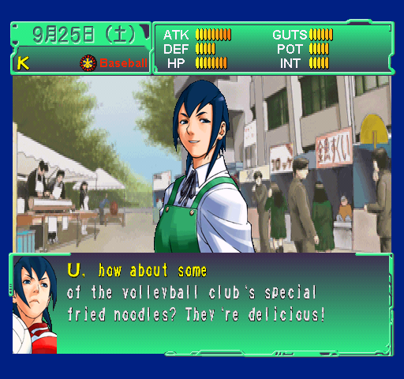
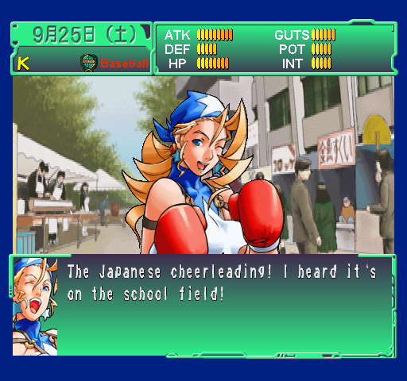
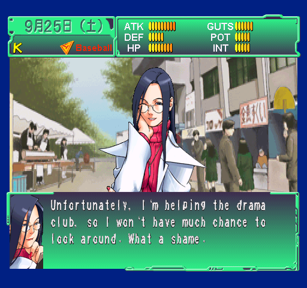
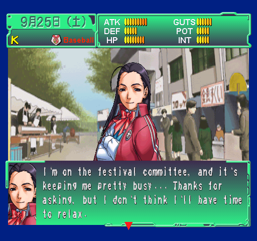

# Shiritsu Justice Gakuen: Nekketsu Seishun Nikki 2

English translation patch for the Japanese PlayStation game (PS1 / PSX, **SLPS-02120**), focused on **School Life mode**.

**Development update — 28 October 2026:** all **18,807 / 18,807 entries in the extracted scenario catalogue** are now translated across their known references in the local v0.102 build. The final pronoun and wording review is complete. This is 100% of the extracted catalogue, not every piece of text in the game or every route playtested.

**Next: combat-exam instructions and move-list screens**, including remaining technique names, headings and related labels. These use data outside the completed scenario catalogue and still contain Japanese. The full number of remaining strings has not been inventoried yet.

**The public download is still v0.64.** It is an older, incomplete preview and does not contain the latest development work. No new patch or translation dump is being published with this status update.

[Download v0.64](https://github.com/ThallhattanCafe/Shiritsu-Justice-Gakuen-Nekketsu-Seishun-Nikki-2/releases/tag/v0.64) · [Installation guide](https://github.com/ThallhattanCafe/Shiritsu-Justice-Gakuen-Nekketsu-Seishun-Nikki-2/wiki/Installation) · [Current development status](STATUS.md)

## What the v0.64 download includes

The patch includes translated School Life menus and character creation text, dialogue and events, summer outings, August camps, September school festivals, and additional friendship scenes. Coverage varies by event and character; this is not a complete English version of the game.

Recent work covers the August festival companions, camps for all five schools, September school scenes and festivals, and further Edge, Hayato and Daigo friendship and birthday dialogue. Some of these branches still need runtime testing.

At the v0.64 release, **7,855 of 18,807 distinct entries** were fully translated across their references (about 41.8%). The local development build has since reached all 18,807. These are text-catalogue counts, not percentages of routes tested or hours playable in English.

## In-game screenshots

These are actual emulator captures of English text included in v0.64, taken during development. They show individual translated scenes and menus, not installation mockups or a complete playthrough.

### Natsu at the festival food stalls.

### Tiffany at the school festival.

### Kyoko talks about helping the drama club.

### The class representative on festival duty.

## Applying the patch

Use an unmodified Japanese BIN/CUE dump of **SLPS-02120**. Apply the BPS patch to the **BIN**, then load its matching CUE in your emulator. Start from the original Japanese image even if you have used an earlier English patch.

The [installation guide](https://github.com/ThallhattanCafe/Shiritsu-Justice-Gakuen-Nekketsu-Seishun-Nikki-2/wiki/Installation) includes the expected hashes and CUE setup. Only the patch, documentation and screenshots are distributed here. No ROM, BIN, ISO, CHD or PlayStation BIOS is included.

## Testing the v0.64 release

An independent BPS decoder reconstructed the exact v0.64 build. Binary, compressed-data and script-structure checks passed. Targeted emulator checks used PCSX ReARMed with HLE/interpreter settings.

Real-BIOS and DuckStation validation is pending. A full school-year playthrough, every festival dance outcome and some newer friendship branches have not been checked. The [current development status](STATUS.md) records the newer build's checks and remaining work; the [wiki status page](https://github.com/ThallhattanCafe/Shiritsu-Justice-Gakuen-Nekketsu-Seishun-Nikki-2/wiki/Translation-status) describes the v0.64 preview.

## Tools

The translation tools are maintained separately in [Recast](https://github.com/ThallhattanCafe/recast).

This is an unofficial fan translation. The original game and its assets belong to Capcom. No affiliation or endorsement is implied.

