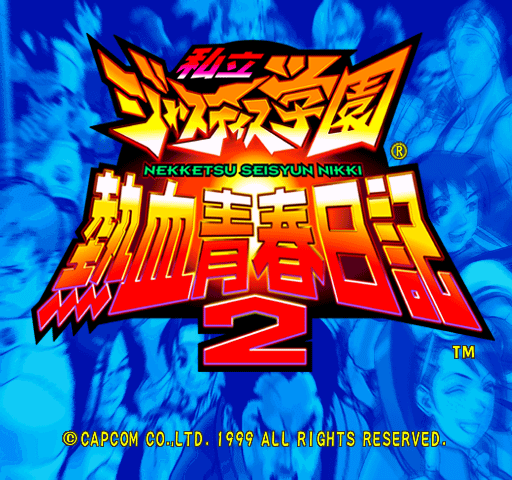
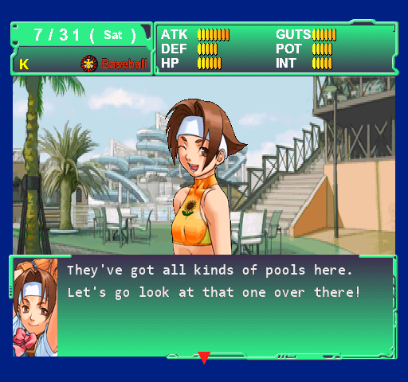
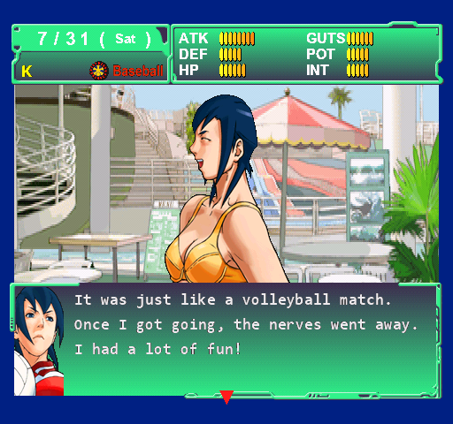
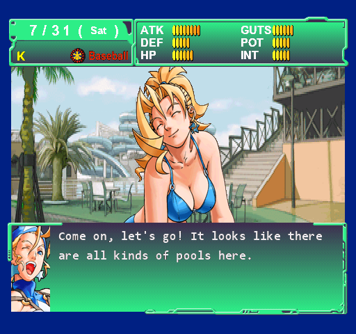
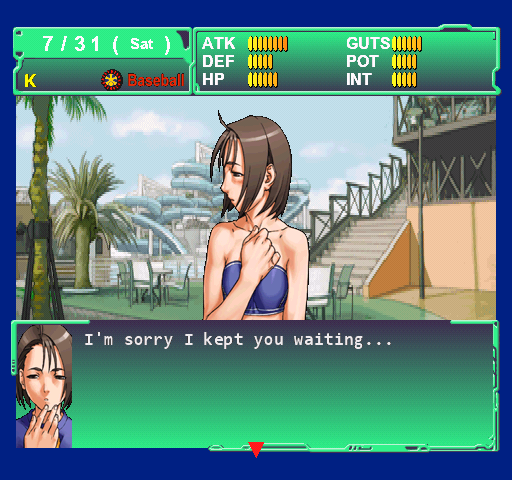
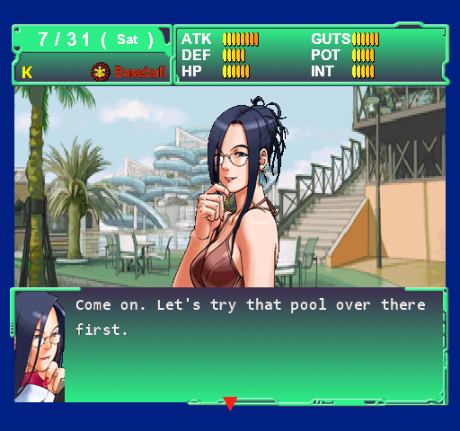
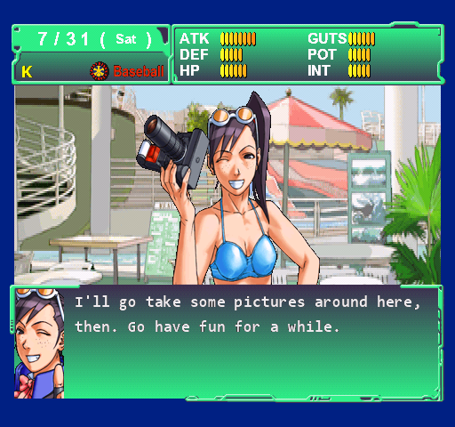

# Shiritsu Justice Gakuen: Nekketsu Seishun Nikki 2 — V1.0.1 - Check releases before reporting black screen issues.

  

Full English translation of **Shiritsu Justice Gakuen: Nekketsu Seishun Nikki 2** and the final version that will receive improvement patches.

Version 1.0.1 includes School Life, UIs, Game Shop, Mini Games, Tests, Arcade Mode, and more.

The translation has been improved compared to previous releases. I am still trying to find better ways to render the texts. Some parts of the translation is still a bit unpolished due to character limits and engine limitation. 

The game has been playtested in all modes, and everything should work as intended. If you find any bugs, please send me a message / open issue.

[Download V1.0](https://github.com/ThallhattanCafe/Shiritsu-Justice-Gakuen-Nekketsu-Seishun-Nikki-2/releases/tag/V1.0) · [Installation](INSTALL.md) · [License](LICENSE)

The patch may be redistributed unchanged. Modifying it requires my prior explicit written permission. I do not own Capcom's game, characters, assets, or other rights; I claim only my own original work. See [LICENSE](LICENSE) for the full terms.

My translations will always be free. If you want to support what I do, please consider donating to [Old Friends Japan](https://old-friends-japan.com/en).

## Pool scenes

### Hinata

  

### Natsu

  

### Tiffany

  

### Akira

  

### Kyoko

  

### Ran

  

