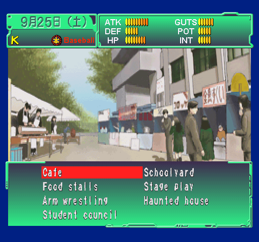
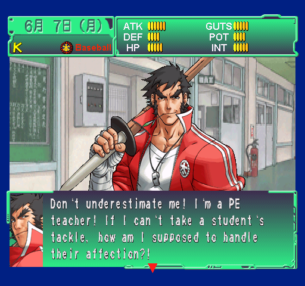
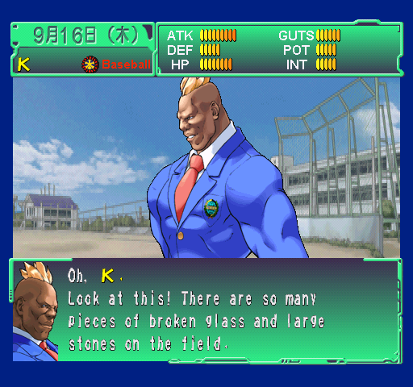
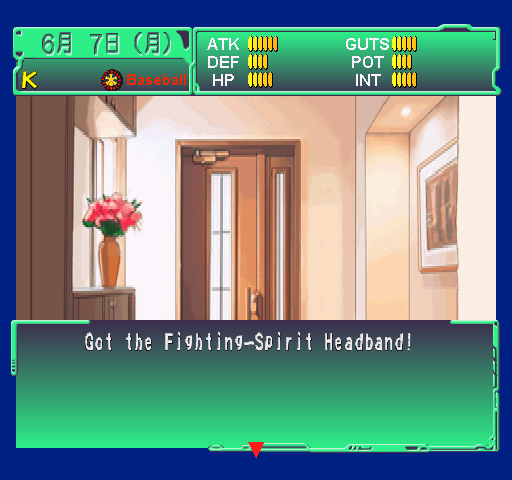

# Shiritsu Justice Gakuen: Nekketsu Seishun Nikki 2

English translation patch for the Japanese PlayStation game (PS1 / PSX, **SLPS-02120**), focused on **School Life mode**.

**v0.64 is a work-in-progress preview.** School Life is not fully translated yet. Japanese dialogue and some Japanese interface text remain, and a complete school-year playthrough has not been verified.

[Download v0.64](https://github.com/ThallhattanCafe/Shiritsu-Justice-Gakuen-Nekketsu-Seishun-Nikki-2/releases/tag/v0.64) · [Installation guide](https://github.com/ThallhattanCafe/Shiritsu-Justice-Gakuen-Nekketsu-Seishun-Nikki-2/wiki/Installation) · [Translation status](https://github.com/ThallhattanCafe/Shiritsu-Justice-Gakuen-Nekketsu-Seishun-Nikki-2/wiki/Translation-status)

## What is included

The patch includes translated School Life menus and character creation text, dialogue and events, summer outings, August camps, September school festivals, and additional friendship scenes. Coverage varies by event and character; this is not a complete English version of the game.

Recent work covers the August festival companions, camps for all five schools, September school scenes and festivals, and further Edge, Hayato and Daigo friendship and birthday dialogue. Some of these branches still need runtime testing.

The extracted catalogue has **7,855 of 18,807 distinct entries fully translated across their references** (about 41.8%). This is a text-catalogue count, not a percentage of routes tested or hours playable in English.

## In-game screenshots

These are actual emulator captures of English text included in v0.64, taken during development. They show individual translated scenes and menus, not installation mockups or a complete playthrough.

### Choosing an activity at the school festival.

### A conversation with Hayato.

### Boman on the school field.

### Receiving the Fighting-Spirit Headband.

## Applying the patch

Use an unmodified Japanese BIN/CUE dump of **SLPS-02120**. Apply the BPS patch to the **BIN**, then load its matching CUE in your emulator. Start from the original Japanese image even if you have used an earlier English patch.

The [installation guide](https://github.com/ThallhattanCafe/Shiritsu-Justice-Gakuen-Nekketsu-Seishun-Nikki-2/wiki/Installation) includes the expected hashes and CUE setup. Only the patch, documentation and screenshots are distributed here. No ROM, BIN, ISO, CHD or PlayStation BIOS is included.

## Testing

An independent BPS decoder reconstructed the exact v0.64 build. Binary, compressed-data and script-structure checks passed. Targeted emulator checks used PCSX ReARMed with HLE/interpreter settings.

Real-BIOS and DuckStation validation is pending. A full school-year playthrough, every festival dance outcome and some newer friendship branches have not been checked. See [translation status](https://github.com/ThallhattanCafe/Shiritsu-Justice-Gakuen-Nekketsu-Seishun-Nikki-2/wiki/Translation-status).

## Tools

The translation tools are maintained separately in [Recast](https://github.com/ThallhattanCafe/recast).

This is an unofficial fan translation. The original game and its assets belong to Capcom. No affiliation or endorsement is implied.
